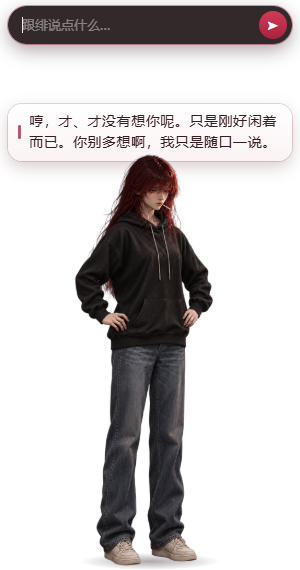
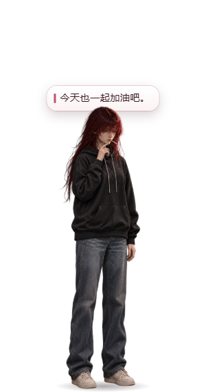
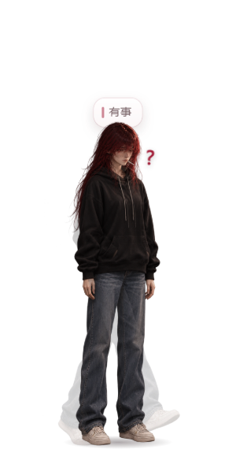
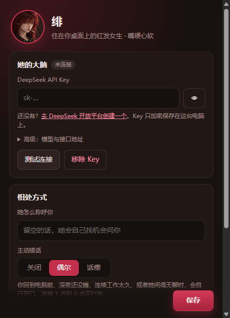

# 卿诗雨 · 会聊天的红发桌宠

住在你 Windows 桌面上的红发女生。会发呆、抽烟、散步，被拎起来会晃，被摔下来会生气；接上 DeepSeek 后能聊天、记住你的事、帮你定提醒，还会偶尔主动搭话。

<p>
  
  
  
  
</p>

## 下载使用（不需要装任何东西）

1. 到本仓库的 **Releases** 页面下载：
   - `CrimsonPet-Setup-x.x.x.exe`：安装版，会创建桌面和开始菜单快捷方式（推荐）
   - `CrimsonPet-Portable-x.x.x.exe`：便携版，双击直接运行，不安装
2. Windows 可能弹出"已保护你的电脑"（因为没有付费代码签名），点 **更多信息 → 仍要运行**。
3. 她会出现在屏幕右下角。

### 接入 DeepSeek（聊天功能）

1. 在 [DeepSeek 开放平台](https://platform.deepseek.com/api_keys) 注册并创建 API Key（需要充一点余额，日常聊天很便宜）。
2. 右键人物 → **设置…** → 粘贴 Key → **测试连接** → **保存**。
3. **双击人物**打开聊天框，Enter 发送，Esc 关闭。

Key 只用系统加密保存在你自己的电脑上，不会上传到任何地方（除了发给 DeepSeek 本身）。

## 怎么和她相处

| 操作 | 她的反应 |
| --- | --- |
| 单击 | 戳她。连续戳：疑惑 → 无奈 → 佯怒，过一会儿消气 |
| 双击 | 打开聊天框 |
| 按住拖动 | 拎起来，会随拖动摆动；松手受重力下落，甩出去会撞墙反弹 |
| 右键 / 托盘图标 | 菜单：聊天、主动搭话频率、动作、散步、大小、设置、退出 |

聊天时她可以：配合情绪做动作和冒表情、走开、定时提醒（"20 分钟后叫我喝水"）、记住你的名字和喜好、读你的剪贴板（你明确提到时）、帮你打开网页（会先弹窗确认）。

**主动搭话**（设置里可选 关闭 / 偶尔 / 话痨）：你离开电脑回来、深夜还没睡、连续工作两小时、或者她闲得无聊时会自己开口；有冷却时间和每日上限，凌晨 1–8 点不打扰，模型觉得没必要时也会选择不说话。

## 开发

需要 Node.js 20+。

```bash
npm install
npm start          # 运行
npm run verify     # 自检：用模拟 LLM 走一遍所有状态，截图写到 logs/
npm run dist       # 打包 Windows 安装版和便携版到 dist/
```

结构：

- `main.js`：窗口、托盘菜单、走路/拖拽/抛掷物理、设置、IPC
- `llm.js`：DeepSeek agent（工具调用循环、记忆、提醒）
- `proactive.js`：主动搭话调度（事件触发 + 随机间隔 + 打扰检查）
- `renderer/state-machine.js`：通用有限状态机
- `renderer/pet.js`：桌宠状态（idle / walk / gesture / chatting / dragged / falling）、气泡、输入
- `renderer/animator.js`：按 atlas 中每帧 `durationMs` 播放精灵动画
- `assets/actions/`：精灵图与 atlas

用户数据（设置、聊天记录、记忆、提醒）保存在 `%APPDATA%\CrimsonPet\`。
